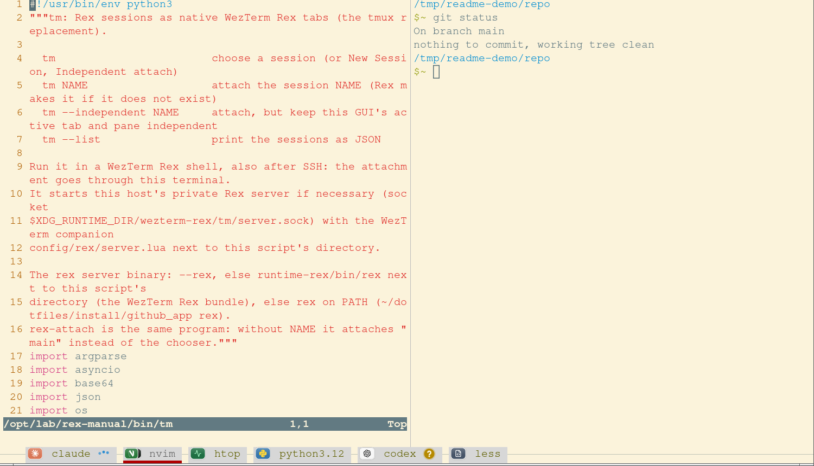
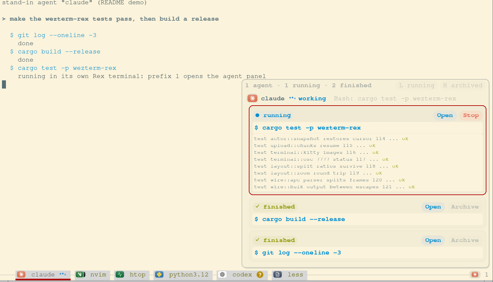
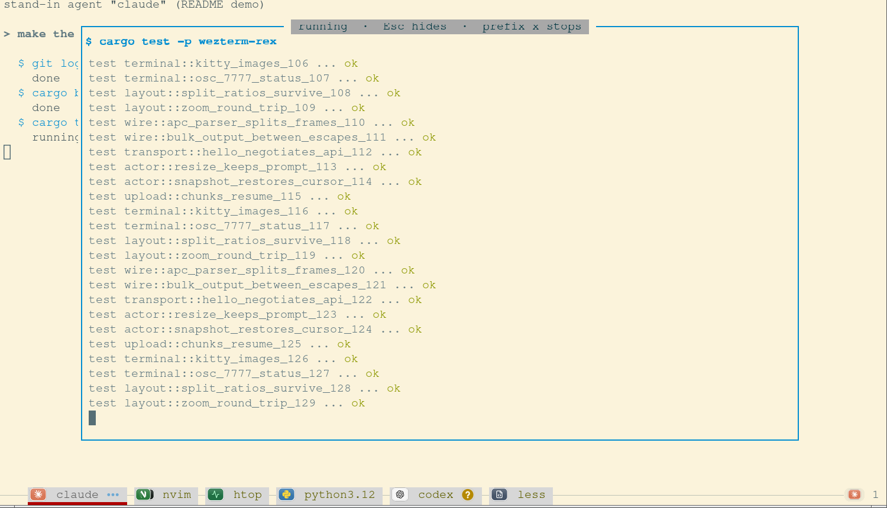
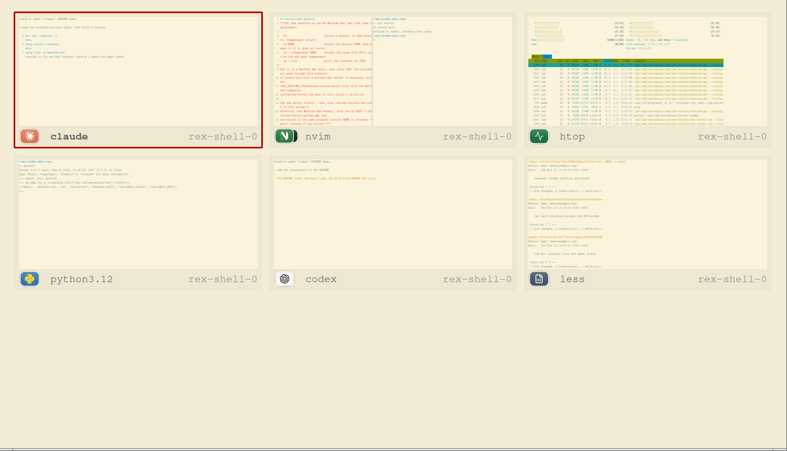

# rexterm

rexterm is [WezTerm](https://wezterm.org) with a native **Rex** domain. Rex is a
terminal session server: your sessions, windows and panes live on the host and
keep running after you detach. rexterm shows a Rex session as ordinary WezTerm
tabs, splits and popups, on your machine or through an SSH shell you already
opened. You get a tmux workflow without tmux in the middle: GPU rendering, real
scrollback, Kitty images and the WezTerm configuration you already have.

rexterm is also made for coding agents. Each tab shows what Claude Code and
Codex are doing. Each command that an agent runs gets its own Rex terminal,
which you can watch, stop or keep.



*One Rex session. Each tab shows a tile for its program (Neovim, htop, Python,
less). The agent status is a drawing: moving dots while Claude works, and a
question bubble while Codex waits for an answer. The red line marks the
active tab. The screenshots come from a test VM, and the two agents are
stand-in programs that send the same hook events as the real ones.*

## Coding agents

The tab bar shows the status of each agent session:

- Moving dots: the agent works. They move also while the window has no focus.
- A question bubble: the agent waits for your answer.
- A check: the agent finished while you looked at another tab. The check goes
  away at your next visit to the tab.

Every shell command of an agent runs in its own Rex terminal, not in a hidden
subprocess. Click the agent button at the right end of the status bar, or press
`prefix l`, to open the agent panel:



The panel lists the agents of the tab and their commands. The selected command
(red frame) shows its live output under the command line. The keys:

| Key | Action |
| --- | --- |
| `j` / `k` | Go to the next or previous agent or command. |
| `l` | Enter an agent, or open the selected command. |
| `x` | Stop the selected command. |
| `h` | Archive a finished command. |
| `H` / `L` | Show archived commands / show only running commands. |

**Open** shows the command's terminal as a popup, with the command pinned under
the title while you scroll:



The popup takes no input: `Esc` hides it (the command goes on), `prefix x` stops
it. A finished command keeps its terminal and its exit status.

Claude Code reports through its hooks and `CLAUDE_CODE_SHELL_PREFIX`
(`rex/bin/rex-agent-status`, `rex/bin/rex-agent-shell`). Codex reports its
status itself (OSC 7501), and its hooks add the commands.

## Made for Rex

- `tm` opens a session chooser, `tm NAME` attaches a session. It works in a
  local shell and after `ssh HOST`: the attachment goes through the terminal you
  already have, with no second SSH connection. `prefix d` detaches to that shell.
- Tabs, splits, zoom, popups and layouts are Rex windows and panes: they survive
  a detach, a GUI restart and a lost connection.
- tmux keys with `Ctrl-Space` as the prefix, and a `prefix a` menu.
- A `prefix ;` command prompt with the tmux commands, for example `kill-pane`,
  `kill-window`, `kill-session` and `kill-server`.
- Copy mode jumps between commands: `Ctrl-k` and `Ctrl-j` move to the previous
  or next command, and `Shift-Y` selects the command at the cursor (multi-line
  commands included). `prefix K` selects the previous command at once.
- `Ctrl-h/j/k/l` move between panes and go through Neovim splits and pickers
  (fzf, Ctrl-R history).
- The window mosaic (`prefix a`, then `M`) shows every window of the session
  with its program:



## Install

The [continuous release](../../releases/tag/continuous) has a Linux x86-64
bundle (glibc 2.39 or later, built on Ubuntu 24.04):

```sh
curl -fLO https://github.com/pchampio/rexterm/releases/download/continuous/rexterm-linux-x86_64.tar.gz
tar -xzf rexterm-linux-x86_64.tar.gz          # makes wezterm-rex/
(cd wezterm-rex && sha256sum -c SHA256SUMS)
ln -s "$(command -v rex)" wezterm-rex/runtime-rex/bin/rex   # a Rex server binary
wezterm-rex/bin/wezterm-rex                   # then run: tm
```

The bundle has no Rex binary: install Rex for your platform, and put it on PATH
or link it as shown. Your `~/.wezterm.lua` stays the base profile. On a remote
host, `tm` needs `rex`, `rex/bin/tm` and `rex/config/rex/server.lua` (the server
companion). See [rex/README.md](rex/README.md).

## Build

`.github/workflows/rexterm.yml` builds and publishes the bundle. By hand, you
need the packages of `get-deps`, Rust 1.99 and Zig 0.17 (for `ghostty-vt`):

```sh
ZIG=/path/to/zig cargo build --locked --release -p wezterm-gui -p wezterm
rex/scripts/package target/release dist
```

## Credits

rexterm is a fork of [ykawa/wezterm](https://github.com/ykawa/wezterm) (WezTerm
with floating panes), itself a fork of [WezTerm](https://github.com/wezterm/wezterm)
by [@wez](https://github.com/wez). The Rex terminal model uses
[libghostty-vt](https://ghostty.org). Program tiles use Lucide and Simple Icons
(see `rex/config/rex/program-icons/NOTICE.md`). Brand logos are trademarks of
their owners. MIT licensed, like WezTerm (`LICENSE.md`).

For everything else (configuration, fonts, key assignments), the WezTerm
documentation applies: https://wezterm.org/
